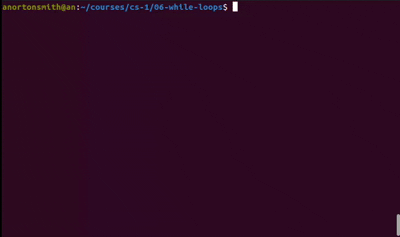

# While Loops

## Variable Updates

```py
n = 1

print(n)
n *= 2

print(n)
n *= 2

print(n)
n *= 2

print(n)
n *= 2

print(n)
```

...

```
1
2
4
8
16
```

## While Loops

```
while <condition>:
    <code block>
```

---

```
1
2
4
8
16
```

...

```py
n = 1

while n < 20:
    print(n)
    n *= 2
```

---

```
Hello!
Hello!
Hello!
Hello!
Hello!
```

...

```py
n = 5

while n > 0:
    print("Hello!")
    n -= 1
```

---

```
5
6
7
8
9
10
```

...

```py
n = 5

while n <= 10:
    print(n)
    n += 1
```

---

```
10
100
1000
10000
100000
```

...

```py
n = 1

while n <= 5:
    print(10 ** n)
    n += 1
```

## Infinite Loops

```py
while True:
    # ...
```

---

```
Enter a number: 5
5
Enter a number: 10
15
Enter a number: -4
11
Enter a number: 33
44
...
```

...

```py
total = 0

while True:
    n = int(input("Enter a number: "))
    total += n
    print(total)
```

...

**Accumulator pattern**

## Break

The `break` keyword stops a while loop. Often used as a way to break out of
otherwise infinite loops.

```
while True:
    ...

    if <condition>:
        break

    ...
```

...

```py
while True:
    name = input("Enter a name: ")
    print(f"Hello {name}!")
```

---

```py
while True:
    name = input("Enter a name: ")

    if name == "":
        break

    print(f"Hello {name}!")
```

...

```
Enter a name: Avery
Hello Avery!
Enter a name: Clementine
Hello Clementine!
Enter a name:
```

## Nested Loops

```py
x = 1

while x <= 4:
    y = 1

    while y <= 3:
        print(f"{x} x {y} = {x * y}")
        y += 1

    x += 1
```

...

```
1 x 1 = 1
1 x 2 = 2
1 x 3 = 3
2 x 1 = 2
2 x 2 = 4
2 x 3 = 6
3 x 1 = 3
3 x 2 = 6
3 x 3 = 9
4 x 1 = 4
4 x 2 = 8
4 x 3 = 12
```

## Problem: Range

```py
# Print the numbers between a given lower and upper bound
#
# Example:
#
# Enter lower bound: 4
# Enter upper bound: 14
# 4
# 5
# 6
# 7
# 8
# 9
# 10
# 11
# 12
# 13
# 14

low = int(input("Enter lower bound: "))
high = int(input("Enter upper bound: "))

# Your code goes here
```

## Problem: Running Maximum

```py
# Keep track of the largest integer entered so far. Assume that the largest
# number is 0 to start.
#
# Example:
#
# Enter a number: 9
# Maximum: 9
# Enter a number: 90
# Maximum: 90
# Enter a number: 7
# Maximum: 90
# Enter a number: 100
# Maximum: 100
# ...

maximum = 0

while True:
    pass  # Your code goes here
```

## Problem: Running Average

```py
# Keep track of the average of the integers entered so far.
#
# Example:
#
# Enter a number: 10
# Average: 10.0
# Enter a number: 4
# Average: 7.0
# Enter a number: 4
# Average: 6.0
# Enter a number: 0
# Average: 4.5
# Enter a number: 100
# Average: 23.6
# ...

count = 0
total = 0

while True:
    pass  # Your code goes here
```

## Problem: Collatz

```py
# Generate the Collatz sequence for a given starting number.
#
# See https://en.wikipedia.org/wiki/Collatz_conjecture
#
# Example:
#
# Enter a starting number: 17
# 17
# 52
# 26
# 13
# 40
# 20
# 10
# 5
# 16
# 8
# 4
# 2
# 1

n = int(input("Enter a starting number: "))

print(n)

while n > 1:
    pass  # Your code goes here
```

https://en.wikipedia.org/wiki/Collatz_conjecture

## Problem: Lyrics

```py
# Print the lyrics to "99 Bottles of Beer". Use "bottle" instead of "bottles"
# when there is only 1 left.
#
# Example:
#
# 99 bottles of beer on the wall, 99 bottles of beer.
# Take one down, pass it around, 98 bottles of beer on the wall.
#
# 98 bottles of beer on the wall, 98 bottles of beer.
# Take one down, pass it around, 97 bottles of beer on the wall.
#
# ...
#
# 2 bottles of beer on the wall, 2 bottles of beer.
# Take one down, pass it around, 1 bottle of beer on the wall.
#
# 1 bottle of beer on the wall, 1 bottle of beer.
# Take one down, pass it around, 0 bottles of beer on the wall.

bottles = 99

while bottles > 0:
    pass  # Your code goes here
```

## Problem: Prime Test

```py
# Determine whether a given number is prime. Assume the number is at least 2.
#
# A number is prime if it has no factors other than 1 and itself.
#
# Example:
#
# Enter a number: 17
# Prime
#
# Example:
#
# Enter a number: 51
# Not prime

n = int(input("Enter a number: "))

isPrime = True
factor = 2

while factor < n:
    pass  # Your code goes here
    
if isPrime:
    print("Prime")
else:
    print("Not prime")
```

## Problem: Prime Factors

```py
# Print the prime factors of a given number, from smallest to largest.
#
# Example:
#
# Enter a number: 60
# 2
# 2
# 3
# 5
#
# Example:
#
# Enter a number: 17
# 17

n = int(input("Enter a number: "))

factor = 2

while n > 1:
    pass  # Your code goes here
```

## Problem: Simplify Fraction

```py
# Simplify the fraction with the given numerator and denominator.
#
# Example:
#
# Enter numerator: 10
# Enter denominator: 24
# Simplified: 5 / 12
#
# Example:
#
# Enter numerator: 5
# Enter denominator: 50
# Simplified: 1 / 10
#
# Example:
#
# Enter numerator: 7
# Enter denominator: 17
# Simplified: 7 / 17

num = int(input("Enter numerator: "))
den = int(input("Enter denominator: "))

factor = 2

# Your code goes here

print(f"Simplified: {num} / {den}")
```

## Problem: Wave

```py
# Generate a sine wave using text characters.
#
# See https://github.com/avery-gfs/cs-curriculum/blob/public/assets/wave.gif

import math
import time

n = 0

while True:
    pass  # Your code goes here
```


