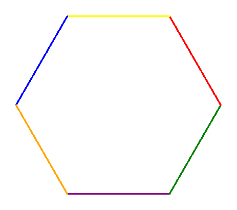
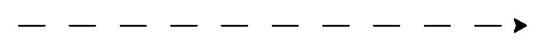
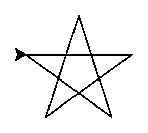
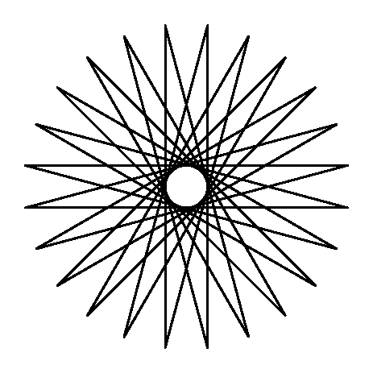
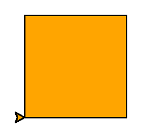
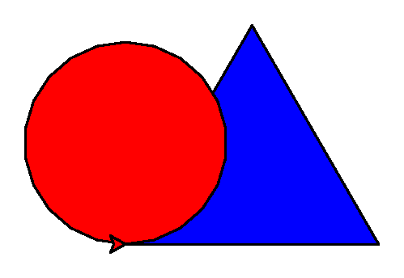
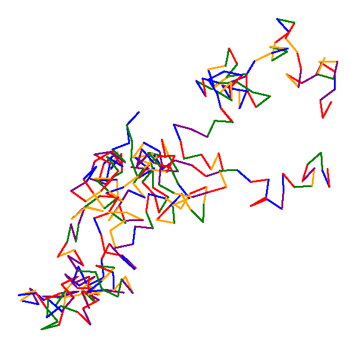
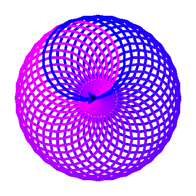
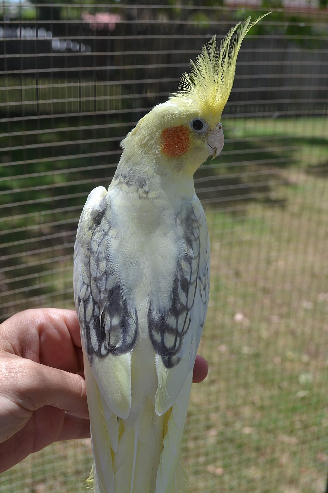

# Turtle

## Starter Code

```py
import turtle

turtle.shape("turtle")

# Your code goes here

turtle.done()
```

## Functions

| Function                       | Meaning                                                          | Example                      |
| ------------------------------ | ---------------------------------------------------------------- | ---------------------------- |
| `turtle.shape(name)`           | Change how the turtle looks (`"turtle"`, `"arrow"`, `"circle"`)  | `turtle.shape("turtle")`     |
| `turtle.forward(n)`            | Move forward `n` pixels                                          | `turtle.forward(100)`        |
| `turtle.backward(n)`           | Move backward `n` pixels                                         | `turtle.backward(50)`        |
| `turtle.right(angle)`          | Turn right by `angle` degrees                                    | `turtle.right(90)`           |
| `turtle.left(angle)`           | Turn left by `angle` degrees                                     | `turtle.left(45)`            |
| `turtle.circle(radius)`        | Draw a circle                                                    | `turtle.circle(50)`          |
| `turtle.circle(radius, angle)` | Draw an arc covering `angle` degrees of a circle                 | `turtle.circle(50, 180)`     |
| `turtle.setheading(angle)`     | Face a direction (`0` east, `90` north, `180` west, `270` south) | `turtle.setheading(90)`      |
| `turtle.home()`                | Move to the center `(0, 0)`, facing east                         | `turtle.home()`              |
| `turtle.teleport(x, y)`        | Jump to `(x, y)` without drawing                                 | `turtle.teleport(-100, 50)`  |
| `turtle.goto(x, y)`            | Move to `(x, y)`, drawing a line on the way                      | `turtle.goto(10, 90)`        |
| `turtle.penup()`               | Stop drawing when moving                                         | `turtle.penup()`             |
| `turtle.pendown()`             | Start drawing when moving                                        | `turtle.pendown()`           |
| `turtle.pensize(width)`        | Set line thickness                                               | `turtle.pensize(5)`          |
| `turtle.pencolor(color)`       | Set line color                                                   | `turtle.pencolor("red")`     |
| `turtle.fillcolor(color)`      | Set fill color                                                   | `turtle.fillcolor("yellow")` |
| `turtle.begin_fill()`          | Start a shape to fill                                            | `turtle.begin_fill()`        |
| `turtle.end_fill()`            | Fill the shape drawn since `begin_fill()`                        | `turtle.end_fill()`          |
| `turtle.speed(n)`              | Set speed (`1` slowest, `10` fast, `0` instant)                  | `turtle.speed(0)`            |
| `turtle.bgcolor(color)`        | Set background color                                             | `turtle.bgcolor("black")`    |
| `turtle.hideturtle()`          | Hide the turtle (handy right before `turtle.done()`)             | `turtle.hideturtle()`        |
| `turtle.reset()`               | Clear the drawing and send the turtle home                       | `turtle.reset()`             |
| `turtle.done()`                | Keep the window open (last line)                                 | `turtle.done()`              |

## Demo: Square

```py
import turtle

turtle.shape("turtle")

turtle.pencolor("purple")

turtle.forward(100)
turtle.left(90)

turtle.forward(100)
turtle.left(90)

turtle.forward(100)
turtle.left(90)

turtle.forward(100)
turtle.left(90)

turtle.hideturtle()
turtle.done()
```

///

...


## Demo: Rainbow Hexagon

```py
import turtle

turtle.shape("turtle")

turtle.pencolor("purple")
turtle.forward(100)
turtle.left(60)

turtle.pencolor("green")
turtle.forward(100)
turtle.left(60)

turtle.pencolor("red")
turtle.forward(100)
turtle.left(60)

turtle.pencolor("yellow")
turtle.forward(100)
turtle.left(60)

turtle.pencolor("blue")
turtle.forward(100)
turtle.left(60)

turtle.pencolor("orange")
turtle.forward(100)
turtle.left(60)

turtle.hideturtle()
turtle.done()
```

///

...



## Demo: Staircase

```py
import turtle

turtle.shape("turtle")

turtle.teleport(-150, -150)
steps = 0

while steps < 6:
    turtle.setheading(90)
    turtle.forward(50)
    turtle.setheading(0)
    turtle.forward(50)
    steps += 1

turtle.hideturtle()
turtle.done()
```

///

...


## Demo: Dashed Line

```py
import turtle

turtle.shape("turtle")

turtle.teleport(-200, 0)
steps = 0

while steps < 20:
    if steps % 2 == 0:
        turtle.pendown()
    else:
        turtle.penup()

    turtle.forward(20)
    steps += 1

turtle.hideturtle()
turtle.done()
```

///

...



## Demo: Star

```py
import turtle

turtle.shape("turtle")

sides = 0

while sides < 5:
    turtle.forward(100)
    turtle.right(144)
    sides += 1

turtle.hideturtle()
turtle.done()
```

///

...



## Demo: Big Star

```py
import turtle

turtle.shape("turtle")

sides = 0
turtle.speed(40)
turtle.backward(100)

while sides < 24:
    turtle.forward(200)
    turtle.right(165)
    sides += 1

turtle.hideturtle()
turtle.done()
```

///

...



## Demo: Sparkle

```py
import turtle

turtle.shape("turtle")

sides = 0
turtle.backward(40)

while sides < 12:
    turtle.forward(40)
    turtle.left(110)
    turtle.forward(40)
    turtle.right(140)
    sides += 1

turtle.hideturtle()
turtle.done()
```

///

...


## Demo: Filled Square

```py
import turtle

turtle.shape("turtle")

turtle.fillcolor("orange")
turtle.begin_fill()

sides = 0

while sides < 4:
    turtle.forward(100)
    turtle.left(90)
    sides += 1

turtle.end_fill()

turtle.hideturtle()
turtle.done()
```

///

...



## Demo: Filled Overlap

```py
import turtle

turtle.shape("turtle")

sides = 0
turtle.fillcolor("blue")
turtle.begin_fill()

while sides < 3:
    turtle.forward(150)
    turtle.left(120)
    sides += 1

turtle.end_fill()

turtle.fillcolor("red")
turtle.begin_fill()
turtle.circle(60)
turtle.end_fill()

turtle.hideturtle()
turtle.done()
```

///

...



## Demo: Initials

```py
import turtle

turtle.shape("turtle")

turtle.pencolor("blue")
turtle.pensize(4)

turtle.teleport(-100, 0)
turtle.left(70)
turtle.forward(100)
turtle.right(140)
turtle.forward(100)
turtle.setheading(0)
turtle.teleport(-100, 0)
turtle.left(70)
turtle.forward(50)
turtle.setheading(0)
turtle.forward(35)

turtle.teleport(10, 0)

turtle.setheading(90)
turtle.forward(100)
turtle.right(160)
turtle.forward(110)
turtle.setheading(90)
turtle.forward(100)

turtle.hideturtle()
turtle.done()
```

///

...


## Demo: Random Walk

```py
import turtle
import random

turtle.shape("turtle")

turtle.speed(0)
steps = 0

while steps < 300:
    heading = random.choice([0, 90, 180, 270])
    turtle.setheading(heading)
    turtle.forward(15)
    steps += 1

turtle.hideturtle()
turtle.done()
```

///

...



## Demo: Circles

```py
import turtle

turtle.shape("turtle")

r = 0
turtle.speed(40)
turtle.pensize(2)
shapes = 0

while shapes < 36:
    turtle.pencolor((r, 0, 1))
    turtle.circle(40)
    turtle.right(10)

    r = (r + 0.03) % 1

    shapes += 1

turtle.hideturtle()
turtle.done()
```

///

...



## Project: Bird



///


