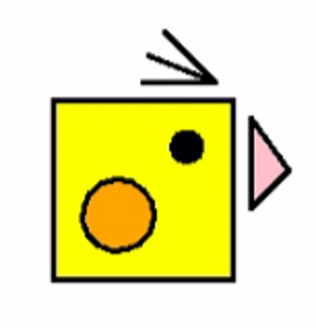
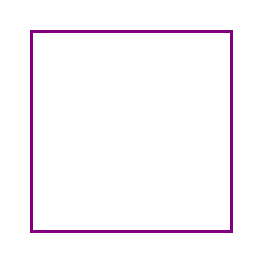
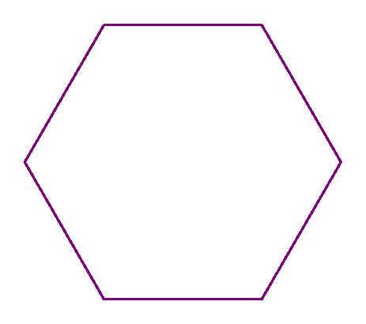
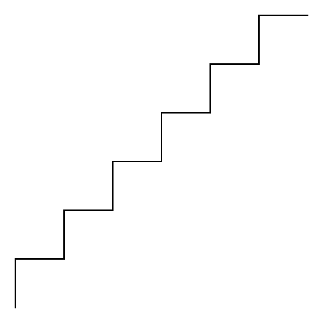
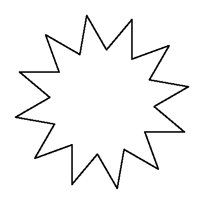
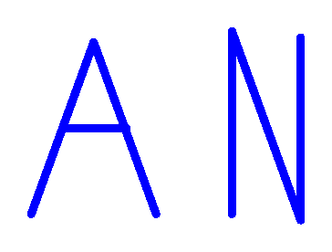
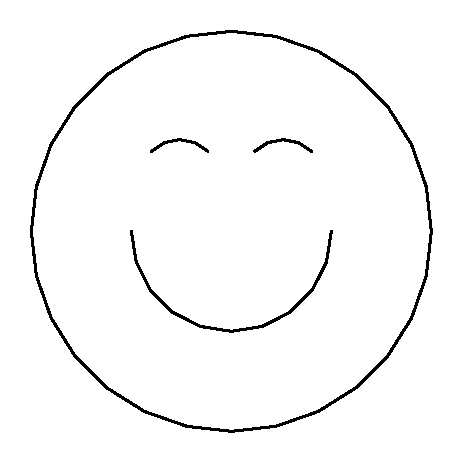
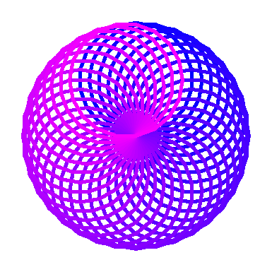

# Turtle

## Demo: Bird


///

...



## Starter Code

```py
import turtle

turtle.shape("turtle")  # Set cursor shape to turtle

# Your code goes here

turtle.done()
```

- `turtle.shape("turtle")` sets the cursor to a turtle icon.
- `turtle.done()` keeps the image open once the drawing is finished.

## Demo: Square

```py
import turtle

turtle.shape("turtle")

turtle.pencolor("purple")

turtle.forward(100)
turtle.left(90)

turtle.forward(100)
turtle.left(90)

turtle.forward(100)
turtle.left(90)

turtle.forward(100)
turtle.left(90)

turtle.hideturtle()
turtle.done()
```

///

...



## Demo: Square Loop

```py
import turtle

turtle.shape("turtle")

turtle.pencolor("purple")

sides = 0

while sides < 4:
    turtle.forward(100)
    turtle.left(90)
    sides += 1

turtle.hideturtle()
turtle.done()
```

///

...


## Demo: Hexagon

```py
import turtle

turtle.shape("turtle")

turtle.pencolor("purple")

sides = 0

while sides < 6:
    turtle.forward(100)
    turtle.left(60)
    sides += 1

turtle.hideturtle()
turtle.done()
```

///

...



## Demo: Staircase

```py
import turtle

turtle.shape("turtle")

turtle.teleport(-150, -150)
steps = 0

while steps < 6:
    turtle.setheading(90)
    turtle.forward(50)
    turtle.setheading(0)
    turtle.forward(50)
    steps += 1

turtle.hideturtle()
turtle.done()
```

///

...



## Demo: Dashed Line

```py
import turtle

turtle.shape("turtle")

turtle.teleport(-200, 0)
steps = 0

while steps < 20:
    if steps % 2 == 0:
        turtle.pendown()
    else:
        turtle.penup()

    turtle.forward(20)
    steps += 1

turtle.hideturtle()
turtle.done()
```

///

...


## Demo: Star

```py
import turtle

turtle.shape("turtle")

sides = 0

while sides < 5:
    turtle.forward(100)
    turtle.right(144)
    sides += 1

turtle.hideturtle()
turtle.done()
```

///

...


## Demo: Big Star

```py
import turtle

turtle.shape("turtle")

sides = 0
turtle.speed(40)
turtle.backward(100)

while sides < 24:
    turtle.forward(200)
    turtle.right(165)
    sides += 1

turtle.hideturtle()
turtle.done()
```

///

...


## Demo: Sparkle

```py
import turtle

turtle.shape("turtle")

sides = 0
turtle.backward(40)

while sides < 12:
    turtle.forward(40)
    turtle.left(110)
    turtle.forward(40)
    turtle.right(140)
    sides += 1

turtle.hideturtle()
turtle.done()
```

///

...



## Demo: Filled Square

```py
import turtle

turtle.shape("turtle")

turtle.fillcolor("orange")
turtle.begin_fill()

sides = 0

while sides < 4:
    turtle.forward(100)
    turtle.left(90)
    sides += 1

turtle.end_fill()

turtle.hideturtle()
turtle.done()
```

///

...


## Demo: Filled Overlap

```py
import turtle

turtle.shape("turtle")

sides = 0
turtle.fillcolor("blue")
turtle.begin_fill()

while sides < 3:
    turtle.forward(150)
    turtle.left(120)
    sides += 1

turtle.end_fill()

turtle.fillcolor("red")
turtle.begin_fill()
turtle.circle(60)
turtle.end_fill()

turtle.hideturtle()
turtle.done()
```

///

...


## Demo: Initials

```py
import turtle

turtle.shape("turtle")

turtle.pencolor("blue")
turtle.pensize(4)

turtle.teleport(-100, 0)
turtle.left(70)
turtle.forward(100)
turtle.right(140)
turtle.forward(100)
turtle.setheading(0)
turtle.teleport(-100, 0)
turtle.left(70)
turtle.forward(50)
turtle.setheading(0)
turtle.forward(35)

turtle.teleport(10, 0)

turtle.setheading(90)
turtle.forward(100)
turtle.right(160)
turtle.forward(110)
turtle.setheading(90)
turtle.forward(100)

turtle.hideturtle()
turtle.done()
```

///

...



## Demo: Face Arcs

```py
import turtle

turtle.shape("turtle")

turtle.teleport(-50, 0)
turtle.right(90)
turtle.circle(50, 180)

turtle.teleport(-40, 40)
turtle.setheading(45)
turtle.circle(-20, 90)

turtle.teleport(40, 40)
turtle.setheading(135)
turtle.circle(20, 90)

turtle.teleport(0, 100)
turtle.setheading(0)
turtle.circle(-100)

turtle.hideturtle()
turtle.done()
```

///

...



## Demo: Random Walk

```py
import turtle
import random

turtle.shape("turtle")
turtle.speed(0)

steps = 0

while steps < 300:
    heading = random.randint(0, 360)
    turtle.setheading(heading)

    color = random.choice([
        "purple",
        "green",
        "red",
        "blue",
        "orange",
    ])

    turtle.pencolor(color)

    turtle.forward(15)
    steps += 1

turtle.hideturtle()
turtle.done()
```

///

...


## Demo: Circle Gradient

```py
import turtle

turtle.shape("turtle")

turtle.speed(40)
turtle.pensize(2)

r = 0
shapes = 0

while shapes < 36:
    turtle.pencolor((r, 0, 1))
    turtle.circle(40)
    turtle.right(10)

    r += 1 / 36
    shapes += 1

turtle.hideturtle()
turtle.done()
```

///

...


