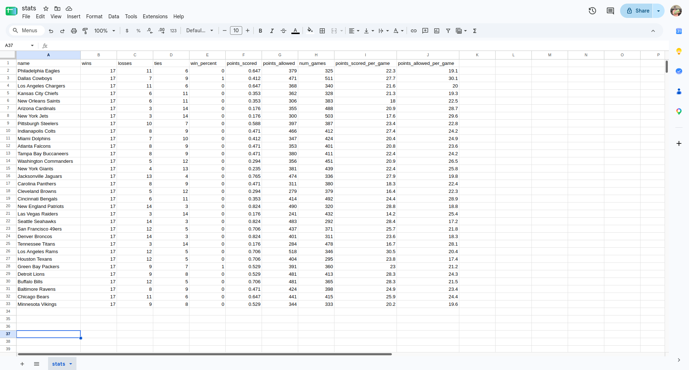

# Sports Stats

## Data Scraping

https://www.footballdb.com/games/index.html

```js
const rows = $$("tr")
  .filter((tr) => !tr.classList.contains("header"))
  .map((tr) =>
    [...tr.querySelectorAll("td")].map((td) => td.innerText).slice(1, 5).join(
      ",",
    )
  )
  .join("\n");

console.log(`away_team,away_score,home_team,home_score\n${rows}`);
```

## CSV Files

CSV: "Comma separated values".

"Tabular data" (data in a table). Like a spreadsheet.

...

```
away_team,away_score,home_team,home_score
Dallas Cowboys,20,Philadelphia Eagles,24
Kansas City Chiefs,21,Los Angeles Chargers,27
Arizona Cardinals,20,New Orleans Saints,13
...
```

...

- Header row
- Records
- Can import and export with spreadsheet programs

...

Real world examples of tabular data?

## Loading CSVs

```
away_team,away_score,home_team,home_score
Dallas Cowboys,20,Philadelphia Eagles,24
Kansas City Chiefs,21,Los Angeles Chargers,27
Arizona Cardinals,20,New Orleans Saints,13
...
```

...

```py
import csv

# Read game data
with open("games.csv") as file:
    games = list(csv.DictReader(file))
```

---

```py
games = [
    {
        "away_team": "Dallas Cowboys",
        "away_score": "20",
        "home_team": "Philadelphia Eagles",
        "home_score": "24",
    },
    {
        "away_team": "Kansas City Chiefs",
        "away_score": "21",
        "home_team": "Los Angeles Chargers",
        "home_score": "27",
    },
    {
        "away_team": "Arizona Cardinals",
        "away_score": "20",
        "home_team": "New Orleans Saints",
        "home_score": "13",
    },
    # ...
]
```

...

What's the issue?

## Converting Numbers

```
away_team,away_score,home_team,home_score
Dallas Cowboys,20,Philadelphia Eagles,24
Kansas City Chiefs,21,Los Angeles Chargers,27
Arizona Cardinals,20,New Orleans Saints,13
...
```

...

```py
import csv

# Read game data
with open("games.csv") as file:
    games = list(csv.DictReader(file))

# Convert scores from strings to numbers
for game in games:
    game["away_score"] = int(game["away_score"])
    game["home_score"] = int(game["home_score"])
```

---

```py
games = [
    {
        "away_team": "Dallas Cowboys",
        "away_score": 20,
        "home_team": "Philadelphia Eagles",
        "home_score": 24,
    },
    {
        "away_team": "Kansas City Chiefs",
        "away_score": 21,
        "home_team": "Los Angeles Chargers",
        "home_score": 27,
    },
    {
        "away_team": "Arizona Cardinals",
        "away_score": 20,
        "home_team": "New Orleans Saints",
        "home_score": 13,
    },
    # ...
]
```

## Reading Values

```py
game = {
    "away_team": "Dallas Cowboys",
    "away_score": 20,
    "home_team": "Philadelphia Eagles",
    "home_score": 24,
}
```

<<<

How would I access the name of the away team from the `game` dictionary?

...

```py
game["away_team"]  # "Dallas Cowboys"
```

<<<

How would I access the score of the home team from the `game` dictionary?

...

```py
game["home_score"]  # 24
```

## Review Dictionaries

https://avery-gfs.github.io/cs-curriculum/slides/view.html?src=cs-2%2F02-dictionaries%2Freadme.md

## Problem: Eagles Record

```
away_team,away_score,home_team,home_score
Dallas Cowboys,20,Philadelphia Eagles,24
Kansas City Chiefs,21,Los Angeles Chargers,27
Arizona Cardinals,20,New Orleans Saints,13
...
```

...

```
Eagles record: 11 6 0
```

(Records are shown as `wins losses ties`)

---

```
Dallas Cowboys,20,Philadelphia Eagles,24
```

<<<

```
Eagles record: 0 0 0
```

<<<

```
Eagles record: 1 0 0
```

---

```
Kansas City Chiefs,21,Los Angeles Chargers,27
```

<<<

```
Eagles record: 1 0 0
```

<<<

```
Eagles record: 1 0 0
```

No change

---

```
Denver Broncos,21,Philadelphia Eagles,17
```

<<<

```
Eagles record: 1 0 0
```

<<<

```
Eagles record: 1 1 0
```

## Problem: All Records

```
Philadelphia Eagles 11 6 0 0.647
Dallas Cowboys 7 9 1 0.441
Los Angeles Chargers 11 6 0 0.647
Kansas City Chiefs 6 11 0 0.353
New Orleans Saints 6 11 0 0.353
Arizona Cardinals 3 14 0 0.176
New York Jets 3 14 0 0.176
Pittsburgh Steelers 10 7 0 0.588
Indianapolis Colts 8 9 0 0.471
Miami Dolphins 7 10 0 0.412
Atlanta Falcons 8 9 0 0.471
Tampa Bay Buccaneers 8 9 0 0.471
Washington Commanders 5 12 0 0.294
New York Giants 4 13 0 0.235
Jacksonville Jaguars 13 4 0 0.765
Carolina Panthers 8 9 0 0.471
Cleveland Browns 5 12 0 0.294
Cincinnati Bengals 6 11 0 0.353
New England Patriots 14 3 0 0.824
Las Vegas Raiders 3 14 0 0.176
Seattle Seahawks 14 3 0 0.824
San Francisco 49ers 12 5 0 0.706
Denver Broncos 14 3 0 0.824
Tennessee Titans 3 14 0 0.176
Los Angeles Rams 12 5 0 0.706
Houston Texans 12 5 0 0.706
Green Bay Packers 9 7 1 0.559
Detroit Lions 9 8 0 0.529
Buffalo Bills 12 5 0 0.706
Baltimore Ravens 8 9 0 0.471
Chicago Bears 11 6 0 0.647
Minnesota Vikings 9 8 0 0.529
```

---

```py
# Keys are team names, values are the win, loss, and tie counts for each team

wins = {}
losses = {}
ties = {}

# Update stats for home and away teams for each game

for game in games:
    pass  # Your code goes here

# Print final stats for each team

for team in wins:
    # Add code to print the win percentage for each team, showing three decimal
    # places for each win percentage value

    winPct = 0  # Your code goes here

    print(team, wins[team], losses[team], ties[team], winPct)
```

## Algorithm

```
Dallas Cowboys,20,Philadelphia Eagles,24
```

<<<

```py
wins: {}

losses: {}

ties: {}
```

<<<

```py
wins: {
  "Dallas Cowboys": 0,
  "Philadelphia Eagles": 0,
}

losses: {
  "Dallas Cowboys": 0,
  "Philadelphia Eagles": 0,
}

ties: {
  "Dallas Cowboys": 0,
  "Philadelphia Eagles": 0,
}
```

<<<

```py
wins: {
  "Dallas Cowboys": 0,
  "Philadelphia Eagles": 1,
}

losses: {
  "Dallas Cowboys": 1,
  "Philadelphia Eagles": 0,
}

ties: {
  "Dallas Cowboys": 0,
  "Philadelphia Eagles": 0,
}
```

---

```
Kansas City Chiefs,21,Los Angeles Chargers,27
```

<<<

```py
wins: {
  "Dallas Cowboys": 0,
  "Philadelphia Eagles": 1,
}

losses: {
  "Dallas Cowboys": 1,
  "Philadelphia Eagles": 0,
}

ties: {
  "Dallas Cowboys": 0,
  "Philadelphia Eagles": 0,
}
```

<<<

```py
wins: {
  "Dallas Cowboys": 0,
  "Philadelphia Eagles": 1,
  "Kansas City Chiefs": 0,
  "Los Angeles Chargers": 0,
}

losses: {
  "Dallas Cowboys": 1,
  "Philadelphia Eagles": 0,
  "Kansas City Chiefs": 0,
  "Los Angeles Chargers": 0,
}

ties: {
  "Dallas Cowboys": 0,
  "Philadelphia Eagles": 0,
  "Kansas City Chiefs": 0,
  "Los Angeles Chargers": 0,
}
```

<<<

```py
wins: {
  "Dallas Cowboys": 0,
  "Philadelphia Eagles": 1,
  "Kansas City Chiefs": 0,
  "Los Angeles Chargers": 1,
}

losses: {
  "Dallas Cowboys": 1,
  "Philadelphia Eagles": 0,
  "Kansas City Chiefs": 1,
  "Los Angeles Chargers": 0,
}

ties: {
  "Dallas Cowboys": 0,
  "Philadelphia Eagles": 0,
  "Kansas City Chiefs": 0,
  "Los Angeles Chargers": 0,
}
```

---

```
Denver Broncos,21,Philadelphia Eagles,17
```

<<<

```py
wins: {
  "Dallas Cowboys": 0,
  "Philadelphia Eagles": 1,
  "Kansas City Chiefs": 0,
  "Los Angeles Chargers": 1,
}

losses: {
  "Dallas Cowboys": 1,
  "Philadelphia Eagles": 0,
  "Kansas City Chiefs": 1,
  "Los Angeles Chargers": 0,
}

ties: {
  "Dallas Cowboys": 0,
  "Philadelphia Eagles": 0,
  "Kansas City Chiefs": 0,
  "Los Angeles Chargers": 0,
}
```

<<<

```py
wins: {
  "Dallas Cowboys": 0,
  "Philadelphia Eagles": 1,
  "Kansas City Chiefs": 0,
  "Los Angeles Chargers": 1,
  "Denver Broncos": 0,
}

losses: {
  "Dallas Cowboys": 1,
  "Philadelphia Eagles": 0,
  "Kansas City Chiefs": 1,
  "Los Angeles Chargers": 0,
  "Denver Broncos": 0,
}

ties: {
  "Dallas Cowboys": 0,
  "Philadelphia Eagles": 0,
  "Kansas City Chiefs": 0,
  "Los Angeles Chargers": 0,
  "Denver Broncos": 0,
}
```

<<<

```py
wins: {
  "Dallas Cowboys": 0,
  "Philadelphia Eagles": 1,
  "Kansas City Chiefs": 0,
  "Los Angeles Chargers": 1,
  "Denver Broncos": 1,
}

losses: {
  "Dallas Cowboys": 1,
  "Philadelphia Eagles": 1,
  "Kansas City Chiefs": 1,
  "Los Angeles Chargers": 0,
  "Denver Broncos": 0,
}

ties: {
  "Dallas Cowboys": 0,
  "Philadelphia Eagles": 0,
  "Kansas City Chiefs": 0,
  "Los Angeles Chargers": 0,
  "Denver Broncos": 0,
}
```

---

```
Philadelphia Eagles,20,Kansas City Chiefs,17
```

<<<

```py
wins: {
  "Dallas Cowboys": 0,
  "Philadelphia Eagles": 1,
  "Kansas City Chiefs": 0,
  "Los Angeles Chargers": 1,
  "Denver Broncos": 1,
}

losses: {
  "Dallas Cowboys": 1,
  "Philadelphia Eagles": 1,
  "Kansas City Chiefs": 1,
  "Los Angeles Chargers": 0,
  "Denver Broncos": 0,
}

ties: {
  "Dallas Cowboys": 0,
  "Philadelphia Eagles": 0,
  "Kansas City Chiefs": 0,
  "Los Angeles Chargers": 0,
  "Denver Broncos": 0,
}
```

...

No new entries

<<<

```py
wins: {
  "Dallas Cowboys": 0,
  "Philadelphia Eagles": 2,
  "Kansas City Chiefs": 0,
  "Los Angeles Chargers": 1,
  "Denver Broncos": 1,
}

losses: {
  "Dallas Cowboys": 1,
  "Philadelphia Eagles": 1,
  "Kansas City Chiefs": 2,
  "Los Angeles Chargers": 0,
  "Denver Broncos": 0,
}

ties: {
  "Dallas Cowboys": 0,
  "Philadelphia Eagles": 0,
  "Kansas City Chiefs": 0,
  "Los Angeles Chargers": 0,
  "Denver Broncos": 0,
}
```

## `dict.setdefault()`

```py
votes = {"strawberry": 1, "chocolate": 1, "vanilla": 2}
votes.setdefault("chocolate", 0)
votes.setdefault("mint", 0)
```

...

```py
{"strawberry": 1, "chocolate": 1, "vanilla": 2, "mint": 0}
```

## Analogy to Scrabble Problem

```
affectionately 25
beautifully 19
contemptuously 23
difficulty 22
extraordinary 24
frontispiece 19
geography 19
hjckrrh 26
inquisitively 28
jumping 19
knocking 19
lazily 18
multiplication 20
neighbouring 19
occasionally 19
puzzling 29
quickly 25
refreshments 20
squeezed 27
thoughtfully 25
uncomfortably 25
vanishing 16
whiskers 18
xii 10
yesterday 16
zigzag 26
```

---

```py
bestWords = {}
bestScores = {}

for word in words:
    score = 0

    for letter in word:
        score += letterPoints[letter]

    firstLetter = word[0]
    bestScores.setdefault(firstLetter, 0)

    if bestScores[firstLetter] < score:
        bestWords[firstLetter] = word
        bestScores[firstLetter] = score
```

## Problem: All Stats

```
away_team,away_score,home_team,home_score
Dallas Cowboys,20,Philadelphia Eagles,24
Kansas City Chiefs,21,Los Angeles Chargers,27
Arizona Cardinals,20,New Orleans Saints,13
...
```

...

```
name:                    Philadelphia Eagles
number of games:         17
wins:                    11
losses:                  6
ties:                    0
win percent:             0.647
points scored:           379
points allowed:          325
points scored per game:  22.3
points allowed per game: 19.1
```

(Printed for every team)

---

Also write the stats to a new CSV file, `stats.csv`:

```
name,wins,losses,ties,win_percent,points_scored,points_allowed,num_games,points_scored_per_game,points_allowed_per_game
Philadelphia Eagles,11,6,0,0.647,379,325,17,22.3,19.1
Dallas Cowboys,7,9,1,0.412,471,511,17,27.7,30.1
Los Angeles Chargers,11,6,0,0.647,368,340,17,21.6,20.0
...
```

## Too Many Dictionaries

```py
wins = {}
losses = {}
ties = {}
```

...

```py
wins = {}
losses = {}
ties = {}
pointsScored = {}
pointsAllowed = {}
numGames = {}
```

---

```py
stats = {
    "Dallas Cowboys": TeamStats("Dallas Cowboys"),
    "Philadelphia Eagles": TeamStats("Philadelphia Eagles"),
    # ...
}
```

...

```py
stats["Philadelphia Eagles"].wins           # 11
stats["Philadelphia Eagles"].pointsScored   # 379
stats["Philadelphia Eagles"].winPercent()   # 0.647...
```

## The `TeamStats` Class

```py
class TeamStats:
    def __init__(self, name):
        self.name = name
        self.wins = 0
        self.losses = 0
        self.ties = 0
        self.pointsScored = 0
        self.pointsAllowed = 0
        self.numGames = 0

    def addStatsHome(self, game):
        pass  # Your code goes here

    def addStatsAway(self, game):
        pass  # Your code goes here

    def winPercent(self):
        return 0  # Your code goes here

    def pointsScoredPerGame(self):
        return 0  # Your code goes here

    def pointsAllowedPerGame(self):
        return 0  # Your code goes here

    def csvRow(self):
        return ""  # Your code goes here
```

## The Main Loop

```py
stats = {}

for game in games:
    homeTeam = game["home_team"]
    awayTeam = game["away_team"]

    stats.setdefault(homeTeam, TeamStats(homeTeam))
    stats.setdefault(awayTeam, TeamStats(awayTeam))

    stats[homeTeam].addStatsHome(game)
    stats[awayTeam].addStatsAway(game)
```

- Make a `TeamStats` object for any team we haven't seen yet
- Tell each team's object about the game

## Updating Stats

```
Dallas Cowboys,20,Philadelphia Eagles,24
```

```py
stats["Philadelphia Eagles"].addStatsHome(game)
```

<<<

```py
name:          "Philadelphia Eagles"
numGames:      0
wins:          0
losses:        0
ties:          0
pointsScored:  0
pointsAllowed: 0
```

<<<

```py
name:          "Philadelphia Eagles"
numGames:      1
wins:          1
losses:        0
ties:          0
pointsScored:  24
pointsAllowed: 20
```

---

```
Philadelphia Eagles,20,Kansas City Chiefs,17
```

```py
stats["Philadelphia Eagles"].addStatsAway(game)
```

<<<

```py
name:          "Philadelphia Eagles"
numGames:      1
wins:          1
losses:        0
ties:          0
pointsScored:  24
pointsAllowed: 20
```

<<<

```py
name:          "Philadelphia Eagles"
numGames:      2
wins:          2
losses:        0
ties:          0
pointsScored:  44
pointsAllowed: 37
```

## Formatting a CSV Row

```py
team.csvRow()
```

...

```
Philadelphia Eagles,11,6,0,0.647,379,325,17,22.3,19.1
```

...

- Same order as the header row
- Win percent: 3 decimal places (`:.3f`)
- Per game stats: 1 decimal place (`:.1f`)

## Stats Spreadsheet Import


