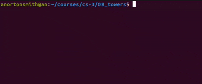

# Towers of Hanoi

## Puzzle



## World Record

https://www.youtube.com/watch?v=TTKwx1xIx6g

## Tower Representation

```txt
      ░             ░             ░       
     ▇▇▇            ░             ░       
    ▇▇▇▇▇           ░             ░       
   ▇▇▇▇▇▇▇          ░             ░       
  ▇▇▇▇▇▇▇▇▇         ░             ░       
 ▇▇▇▇▇▇▇▇▇▇▇        ░             ░       
▇▇▇▇▇▇▇▇▇▇▇▇▇       ░             ░ 
  
      0             1             2
```

...

```py
towers = [[6, 5, 4, 3, 2, 1], [], []]
```

...

```py
towers[0]  # [6, 5, 4, 3, 2, 1]
```

...

```py
towers[1]  # []
```

...

```py
towers[0][-1]  # 1
```

## Stacks

"Last in, first out" datastructure. We can represent them using lists in Python.

```py
values = ["a", "b", "c"]
```

...

Pop (remove last) `pop`

```py
values.pop()  # values = ["a", "b"]
```

...

Push (add value) `append`

```py
values.append("d")  # values = ["a", "b", "d"]
```

...

Check last (without removing)

```py
values[-1]  # "d"
```

...

What are some real-life examples of stacks?

...

- Browser history
- Loading truck (shelf before books)

## Functions

```py
moveSingle(src, dest)
```

Move a single disc from the top of tower `src` to tower `dest`.

For example, if `towers` is

`[[6, 5, 4], [3, 2, 1], []]`

and we run

`moveSingle(0, 2)`

then `towers` will become

`[[6, 5], [3, 2, 1], [4]]`

## Functions

```py
solve(src, dest, depth)
```

Using recursion, move the top `depth` discs from tower `src` to tower `dest`.

For example, if `towers` is

`[[6, 5, 4, 3, 2, 1], [], []]`

and we run

`solve(0, 2, 3)`

then `towers` will become

`[[6, 5, 4], [], [3, 2, 1]]`

## Algorithm

To move `n` discs from the `src` tower to the `dest` tower:

...

- Move `n - 1` discs from the `src` tower to the `tmp` tower
- Move the next `n`th disc from the `src` tower to the `dest` tower
- Move `n - 1` discs from the `tmp` tower to the `dest` tower

...

Where does `* 2 + 1` pattern in step counts come from?

...

```txt
steps(n + 1) = 2 * steps(n) + 1
```
